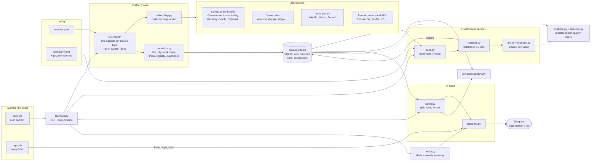

# AI Job Finder

Collects tech jobs every morning from company job boards (Greenhouse, Lever, Ashby, SmartRecruiters, Workday,
Workable, Oracle Cloud HCM, Eightfold, Rippling, Jibe, SuccessFactors and more), big employers' own career sites
(Amazon, Google, Apple, IBM, Goldman Sachs, Wipro, HCLTech, Uber, ...), Indian job portals (LinkedIn, Naukri via
AmbitionBox, Foundit, Hirist, Instahyre, TimesJobs, Shine, Cutshort, Wellfound, Internshala, Freshersworld,
Unstop) and remote job boards, keeps the ones open to people in India, and sends each person a short ranked list
on Telegram by 7:00 AM IST.

Design: `AI_Job_Finder_Project_Report.md`. Build plan and status: `PLAN.md`.

## Architecture



Each morning `daily` runs three stages over one SQLite file: **collect** fetches every active source in
`config/sources.yaml` and stores new or changed jobs; **match** drops jobs that fail a person's hard rules and asks
Claude to score the rest; **send** picks each person's best new matches and sends them on Telegram. The hourly job
saves button taps and tells you if the daily run has stopped.

## Setup (once)

```sh
uv sync                       # Python 3.12 and the dependencies
cp .env.example .env          # then fill in the Telegram bot token and your own chat ID
claude                        # log in to Claude Code once; matching runs `claude -p` on your plan
```

Install the daily schedule with the steps in `launchd/README.md`.

## Run

```sh
uv run python -m src.main daily              # everything: collect, match, send (what the 6:45 job runs)
uv run python -m src.main collect            # only fetch jobs (no AI); also refreshes all_jobs.csv
                                             # skips sources scanned in the last day: --days N to change, --all to scan every one
uv run python -m src.main export             # rewrite private/exports/all_jobs.csv from the stored jobs
uv run python -m src.main match              # only score new jobs for each person
uv run python -m src.main digest --dry-run   # print each person's list without sending it
uv run python -m src.main health             # the weekly health summary (add --send to send it to you)
uv run pytest -q                             # offline tests
```

Logs from the scheduled runs are in `private/logs/`.

## Browse every job yourself (no AI)

`collect` writes `private/exports/all_jobs.csv`: every job found so far, newest first, with company, title,
location, work mode, India eligibility, experience range, salary (when listed), status (open, possibly_closed,
closed) and apply link. Open it in Excel, Numbers or Google Sheets and filter it yourself.
No Claude login or Telegram setup is needed for this.

## Share the bot (no setup per person)

Anyone who opens the bot and taps **Start** is subscribed. Every morning the daily run sends all subscribers the
same two lists, with no profile and no AI: new **software internships** and new **jobs for 2027 graduates** open
to people in India (any city, or remote). They use the rules behind `india_internships.csv` and
`graduates_2027.csv`; an internship appears only in the first list. Each list shows up to 25 jobs a day
(postings older than 14 days are left out), and one posting in several cities is listed once.

Bot commands: `/start` subscribes and sends the newest jobs, `/latest` shows them again, `/id` shows the chat ID,
`/stop` unsubscribes, `/help`. The `taps` job answers them every minute, so the bot replies only while this Mac is on and awake.
People who block the bot are unsubscribed automatically. Code: `src/broadcast.py`.

```sh
uv run python -m src.main share                 # collect (skips sources scanned in the last day), then send
                                                # the new jobs to every subscriber; --days N or --all to change
uv run python -m src.main broadcast --dry-run   # print the next list and the subscriber count, send nothing
```

`share` can run any time, more than once a day: each job is sent only once, and nothing is sent when there is
nothing new. The scheduled daily run also sends the lists, at most once a day.

## Add a person with their own AI-ranked list (about 5 minutes)

1. Ask them to open the bot in Telegram and send `/id`. Within the hour the bot replies with their chat ID
   (or run `uv run python -m src.main taps` to get it now).
2. Copy the template: `cp config/profiles/example.yaml config/profiles/<name>.yaml`. The file name is their ID.
3. Fill in `name`, `telegram_chat_id`, `target_roles`, `seniority`, `experience_years`, skills and `locations`.
   The comments in the template explain each field.
4. Optional: save their resume as plain text in `private/resumes/<name>.txt` and set `resume_file`.
5. Check it: `uv run python -m src.main match` then `uv run python -m src.main digest --dry-run`.

Their first list covers only jobs from the last 7 days and has at most 10 jobs.

## Add a company (about 2 minutes)

1. Find its job board. The board name is the last part of the URL:
   - Greenhouse: `boards.greenhouse.io/<board>` or `job-boards.greenhouse.io/<board>`
   - Lever: `jobs.lever.co/<board>`
   - Ashby: `jobs.ashbyhq.com/<board>`
   - SmartRecruiters: `jobs.smartrecruiters.com/<board>` (the board name is case-sensitive)
   - Workday: use the whole career site URL as the board, e.g.
     `board: "https://nvidia.wd5.myworkdayjobs.com/NVIDIAExternalCareerSite"`
   - Workable: `apply.workable.com/<board>`
   - Rippling: `ats.rippling.com/<board>/jobs`
   - Oracle Cloud HCM: use the whole career site URL, e.g.
     `board: "https://jpmc.fa.oraclecloud.com/hcmUI/CandidateExperience/en/sites/CX_1001"`
   - Eightfold: the career site URL plus the company's domain, e.g.
     `board: "https://qualcomm.eightfold.ai/careers?domain=qualcomm.com"`
   - Jibe (iCIMS): the career site's base URL, e.g. `board: "https://careers.amd.com"`
   - Amazon: `type: amazon, board: IND` (a country code; only tech job categories are kept)
   - RippleHire: the career site link with its token, plus `#list/geo=India` where the site offers that filter, e.g.
     `board: "https://ltimindtree.ripplehire.com/candidate/?token=xviyQvbnyYZdGtozXoNm#list/geo=India"`
   - Phenom: the career site URL with its locale path, e.g. `board: "https://careers.nttdata.com/global/en"`
   - Avature: the portal URL plus the search words, e.g.
     `board: "https://jobs.siemens.com/en_US/externaljobs?search=India"`
   - TalentBrew (Radancy), iCIMS classic: the career site's base URL, e.g. `board: "https://careers.arm.com"`
     or `board: "https://ideasglobal-sas.icims.com"`. These are read through the site's sitemap and job pages.
   - SAP SuccessFactors: the career site URL plus its India filter, e.g. `type: sapsf,
     board: "https://careers.wipro.com?location=India"` (look at the site's search results to find the filter)
   - Any other site whose sitemap lists job pages with a number at the end of the URL: `type: sitemap` and the
     sitemap URL, e.g. `board: "https://jobs.uber.com/en/jobs/sitemap.xml"` (the pages need schema.org job data)
2. Add a line to `config/sources.yaml`: `- {name: Acme, type: lever, board: acme}`
3. Check it: `uv run python -m src.main collect` should show `ok  Acme  N jobs`.

On its first scan, jobs older than 7 days are stored as already seen, so nobody gets a flood of old jobs.
To pause a company, add `active: false` to its line.

SmartRecruiters, Workday, Oracle, Eightfold, Rippling, RippleHire, Phenom, Avature, TalentBrew, iCIMS,
SuccessFactors, LinkedIn and Instahyre sources open each new job's page once for its description, so a big
source's first scan takes a few minutes; later scans only open new jobs. They open at most 100-200 new jobs per
scan, newest first where the site allows; the rest follow on the next scans.

### Job portals and career sites read through their web pages (added 2026-10-25)

These need no key or login. Most of them refuse unknown programs but answer a normal browser, so these readers
send a browser User-Agent. LinkedIn Jobs, Foundit, Google Careers, Wipro and HCLTech use pages their robots.txt
asks crawlers to avoid; they are read on purpose, about one call a second (LinkedIn every 2 seconds, and it
stops opening job pages at the first "slow down" answer). Code: `src/collect/indiaportals.py` (portals),
`src/collect/careersites.py` (company sites) and `src/collect/jobpages.py` (sitemap and job-page readers).
- Short descriptions only: Hirist, iimjobs, Foundit, Naukri via AmbitionBox (skills list), TimesJobs, Shine and
  IBM (a snippet). The AI match has less to go on for these.
- AmbitionBox shows Naukri's jobs. Only the first page (20 newest) of each list is readable without a bot check,
  so its source lists 15 keyword pages.
- Instahyre's list has no dates or sort order, and many of its jobs are years old.
- Shine's API was slow and returned errors for a while on 2026-10-25; a failed scan just shows in the health summary.
- Wellfound, TimesJobs, The Muse and Uber also return jobs outside India; the rules drop those.

Still left out (details and reasons in `config/unsupported_sources.yaml`):
- Bot checks even for a browser User-Agent: Indeed, Glassdoor, Naukri's own search (reCAPTCHA), SimplyHired,
  ZipRecruiter, Monster, Startup Jobs, StepStone, Totaljobs, SEEK, JobStreet, Bayt, GulfTalent and others.
  These would need a real (headless) browser.
- Reachable but few India tech jobs: Apna, WorkIndia, Golang Cafe, remote boards such as JustRemote and Flexa,
  and US / UK / Europe portals.
- Company sites whose job list could not be found: SAP, Globant, Walmart, TCS, PhonePe, Zomato, Zepto, Myntra.
  Many of their jobs arrive through LinkedIn, Naukri, Instahyre or Hirist anyway.
- Login needed (Superset, freelance marketplaces), government portals (notices and PDFs), staffing firms.

Remote job boards Remote OK, Remotive, Working Nomads, Jobspresso and Jobicy have few jobs open to India (about
15 a day between them, plus ~40 of Jobicy's newest 100); each costs one call per scan. YC jobs need a free YC
account to apply. Jooble, Careerjet and Adzuna use official APIs with a key in `.env` (Adzuna stays off in
`sources.yaml` until its app ID and key are there).

## Where data lives

Everything personal stays on this Mac in folders git ignores:

| What | Where |
| --- | --- |
| Profiles | `config/profiles/<name>.yaml` (only `example.yaml` is committed) |
| Resumes | `private/resumes/` |
| Jobs, matches, run history | `private/jobs.db` (SQLite) |
| Full list of each person's matches | `private/exports/<name>.csv` |
| Every collected job | `private/exports/all_jobs.csv` |
| Logs | `private/logs/` |
| Match-quality labels | `tests/labels/<name>.csv` and `.jobs.jsonl` |
| Telegram token, your chat ID | `.env` |

Run logs and AI call logs older than 30 days are deleted automatically. Jobs are kept.

## Delete someone's data

```sh
rm config/profiles/<name>.yaml private/resumes/<name>.*
uv run python -m src.main forget <name>
```

`forget` deletes their matches, AI call log, list export, labels and cached evaluation results. It refuses to run
while their profile still exists, because the next run would add them back.

## Check match quality

Each person labels 30–50 jobs; the AI has to rank them better than simple keyword overlap.

```sh
uv run python -m src.evaluate export <name>          # adds 50 jobs to tests/labels/<name>.csv (15 kept aside)
# fill in the `label` column: good, maybe or no
uv run python -m src.evaluate compare <name> --train  # use while changing prompts or rules
uv run python -m src.evaluate compare <name>          # the kept-aside jobs: use only to decide
```

When you change the prompt in `src/prompts.py`, bump `RUBRIC_VERSION`. AI results are cached per version, so a
comparison only calls the AI again after a change.
